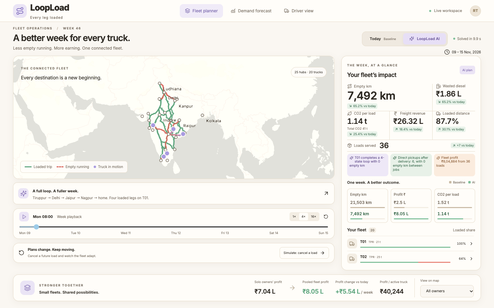
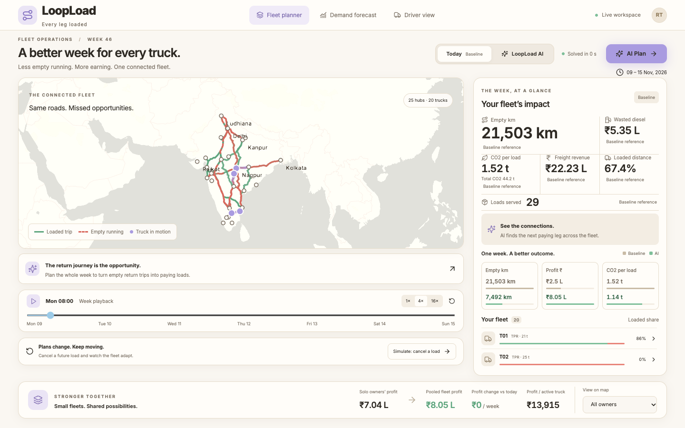
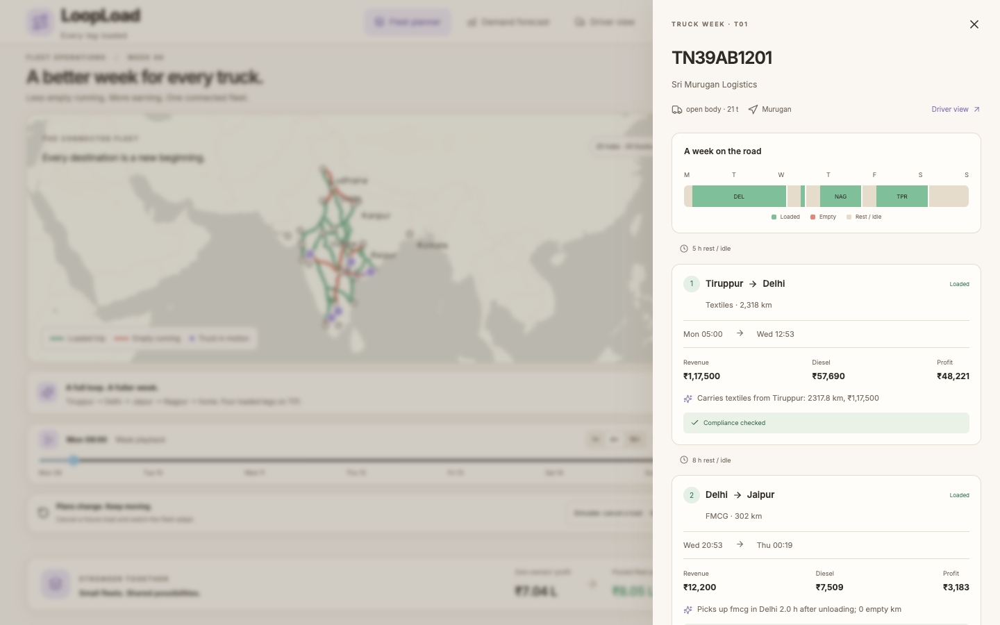
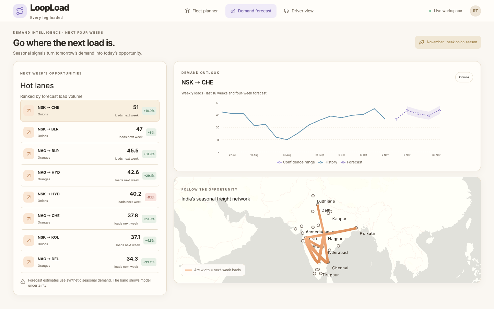
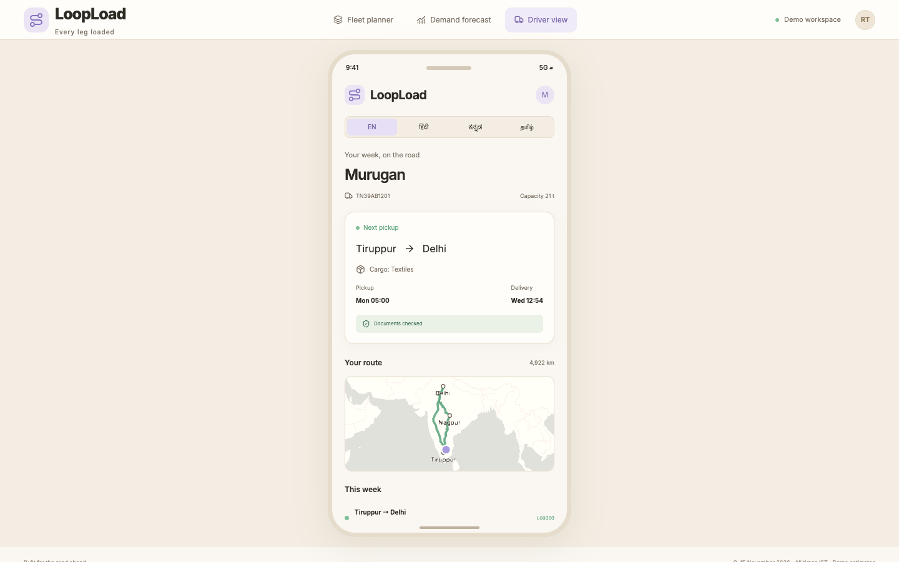

# LoopLoad

**AI that plans a truck's whole week in advance, so it never has to drive back empty.**

Most of India's trucks belong to small operators who find return loads one trip at a time, through calls and WhatsApp. So trucks wait for days or drive home empty. LoopLoad is an AI trip-chain planner. It forecasts where cargo will be, builds the most profitable multi-state loop for each truck, and pools small fleets so they plan like one large company.

> Built at the NHCE Ideathon 2026. The data is synthetic but realistic — see the assumptions below.



## Headline numbers (seed-42 demo scenario)

| | Baseline | AI | Change |
| --- | ---: | ---: | ---: |
| Empty km | 21,503 | 7,492 | -14,011 km (32.6% → 12.3% empty) |
| Loads served | 29 | 36 | +7 |
| Profit | ₹2.50L | ₹8.05L | +₹5.54L |
| CO₂ | 44.2 t | 41.0 t | -3.3 t |

Regenerate these (and the matching charts) at any time with:
```sh
backend/.venv/bin/python scripts/pitch_numbers.py
```
See [`demo/pitch_numbers.md`](demo/pitch_numbers.md) for the full table and the exact pitch wording.

## What's in the demo
- A live India map where empty legs (red, dashed) turn into loaded legs (green) when you press **AI Plan**
- Baseline ("how it works today") vs the AI optimiser, with empty km, profit, diesel and CO₂ compared
- A full week per truck, with e-way bill and permit compliance checks
- Live re-planning when a load is cancelled
- Demand forecasting and hot lanes for next week
- A driver app view in English, Hindi, Kannada and Tamil

## Quick start

```sh
make setup   # creates backend/.venv, installs backend + frontend deps
make dev     # runs the API on :8000 and the Vite dev server on :5173
```

Or by hand:
```sh
# Terminal 1 — backend
python3.12 -m venv backend/.venv
backend/.venv/bin/pip install -r backend/requirements.txt
cd backend && PYTHONPATH=. .venv/bin/uvicorn app.main:app --reload --port 8000

# Terminal 2 — frontend
cd frontend && npm install
npm run dev
```

Then open `http://localhost:5173`. The frontend talks to the live API by default and only
falls back to the bundled mocks in `frontend/src/mocks/` if the API is unreachable (set
`VITE_USE_MOCKS=true` to force offline mode).

Run the test suites with:
```sh
cd backend && PYTHONPATH=. .venv/bin/pytest -q      # 82 tests
cd frontend && npx playwright test                   # 11 end-to-end tests
```

## Screenshots

| Baseline | AI plan |
| --- | --- |
|  |  |

| Truck week (T01) | Demand forecast | Driver view |
| --- | --- | --- |
|  |  |  |

A full recorded walkthrough (video + step screenshots) is in [`demo/`](demo/): run
`scripts/record_demo.py` to regenerate it against a running API and frontend.

## Architecture

- **`backend/app/`** — FastAPI app, request/response schemas, config and assumptions.
- **`backend/engine/`** — baseline planner, OR-Tools chain optimiser, metrics, compliance checks, live re-plan.
- **`backend/data/`** — scenario generator, road distance/path caches (OSRM), demand forecasting.
- **`frontend/`** — React + Vite + TypeScript, deck.gl over a MapLibre basemap, Tailwind, framer-motion.
- Plans are held in memory per backend process (`STATE`); nothing is persisted to disk beyond the checked-in data caches.

Built with Python · FastAPI · Google OR-Tools · statsmodels · OSRM / OpenStreetMap · React · deck.gl · MapLibre · Tailwind.

## API

All endpoints are under `/api`. See [`docs/CONTRACT.md`](docs/CONTRACT.md) for the exact JSON shapes.

| Method | Path | Purpose |
| --- | --- | --- |
| GET | `/health` | Liveness check |
| GET | `/scenario` | Current scenario (cities, trucks, owners, loads) |
| POST | `/scenario/regenerate` | Regenerate a scenario for a given seed |
| POST | `/plan` | Get (or build) the baseline / AI / solo plan |
| GET | `/plan/{plan_id}` | Fetch a specific plan by id |
| GET | `/compare` | Baseline vs AI metrics and their delta — the "money shot" |
| POST | `/replan` | Re-plan after a cancelled load, delay, or new load |
| GET | `/trucks/{truck_id}/week` | One truck's week on a given plan |
| GET | `/owners/{owner_id}/summary` | One owner's trucks and metrics on a given plan |
| GET | `/forecast` | Next-4-week demand forecast, optionally by lane |
| GET | `/hot-lanes` | Top lanes by predicted demand next week |
| GET | `/compliance/{load_id}` | E-way bill / permit / weight compliance for one load |

## Docs
- [`docs/FEATURES.md`](docs/FEATURES.md): every feature, how it's built, and the demo script
- [`docs/CONTRACT.md`](docs/CONTRACT.md): shared data shapes, API and file ownership
- [`docs/PLAN.md`](docs/PLAN.md): the original parallel build plan

## Assumptions

All configurable in `backend/app/config.py`:

- Diesel ₹90/L, loaded HCV mileage 4 km/L, toll ₹5/km → cost ≈ ₹27.5/km
- CO₂ 2.68 kg per litre of diesel
- Freight rates ₹38–55/km by commodity, from the scenario generator
- Driver rest: an 8 h break after every 10 h of driving; 3 h service time at each pickup and delivery
- E-way bill required above ₹50,000; validity 1 day per 200 km (minimum 1 day)
- The scenario (20 trucks, ~140 loads, 25 Indian freight cities) and the 104-week demand history are synthetic, generated from real seasonal freight flows (onions, cotton, oranges, festival FMCG, wheat), seeded for reproducibility (seed 42)

## Team

Built by Prithvi Muchalambe for the NHCE Ideathon 2026, with Claude Code as engineering lead and pair.
